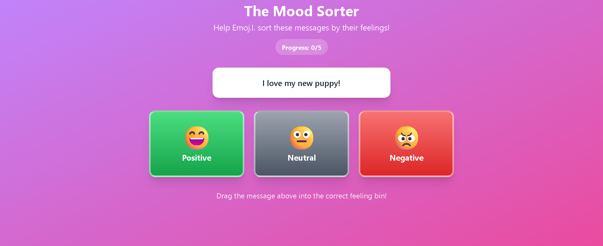
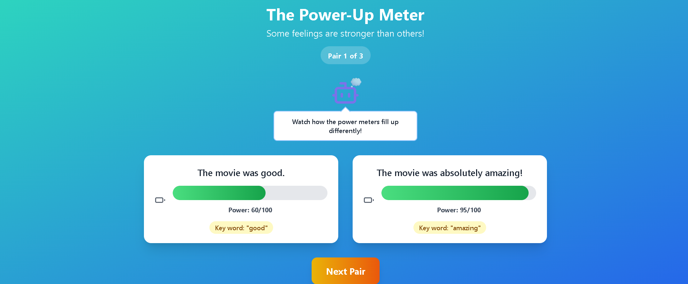
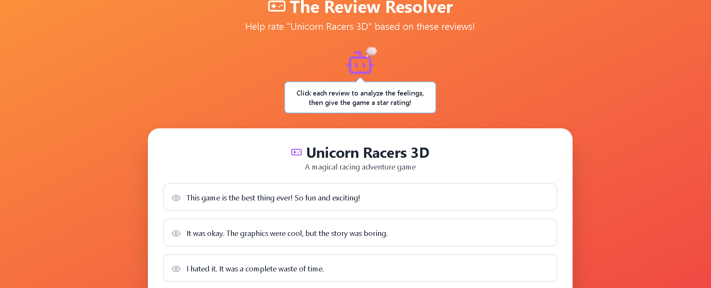
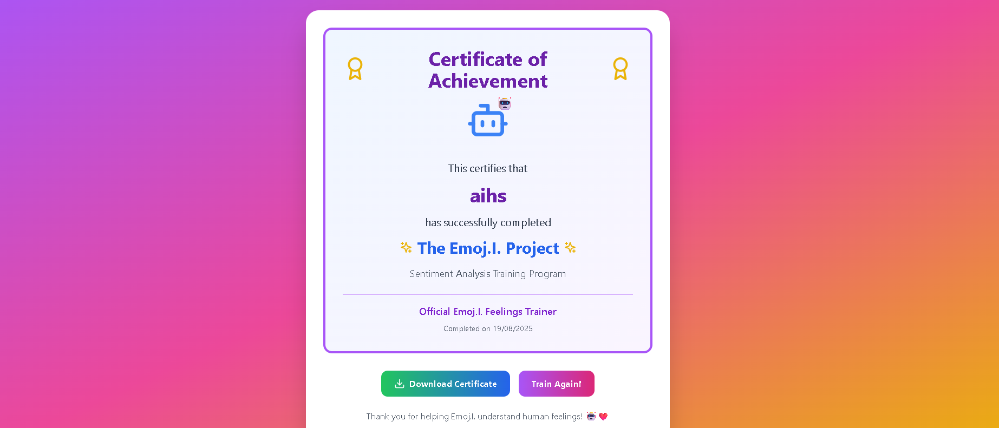

# 🤖 The Emoj.I. Project  

**An interactive sentiment analysis adventure game for educational purposes!**  

The Emoj.I. Project is a fun, educational web app featuring **Emoj.I.**, a friendly robot guide who needs help understanding human emotions. Through interactive challenges, students learn about **sentiment analysis** in an engaging, gamified environment.  

---

## ✨ Features

- 🎭 **Interactive Adventure Gameplay** – Learn sentiment analysis step by step with guided challenges.  
- 🧩 **Three Progressive Learning Modules**:  
  - **Mood Sorter** – Introduces basic sentiment classification with drag-and-drop activities.  
  - **Power-Up Meter** – Teaches **sentiment intensity** with sliders and animated power meters.  
  - **Review Resolver** – Applies skills to **real-world text analysis** with mixed sentiments.  
- ⚡ **Instant Feedback** – Animations, hints, and explanations for intuitive learning.  
- 🎨 **Kid-Friendly Design** – Vibrant gradients, smooth animations, large touch targets.  
- 📱 **Responsive & Accessible** – Works across devices with high contrast and accessible layouts.  
- 🏆 **Downloadable Certificate** – Kids finish with a personalized achievement certificate.  

---

## 🖼️ Screenshots

| Module | Screenshot |
|--------|-------------|
| **Home Screen** |  |
| **Mood Sorter** |  |
| **Power-Up Meter** |  |
| **Review Resolver** |  |
| **Certificate Screen** |  |

